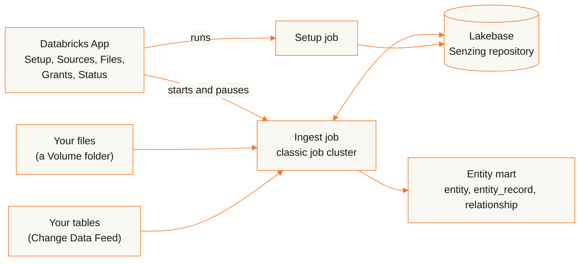

<p align="center">
  <picture>
    <source media="(prefers-color-scheme: dark)" srcset="assets/senzing-logo-dark-theme.png">
    
  </picture>
</p>

<h1 align="center">sz-databricks</h1>

<p align="center"><b>Entity resolution inside your own Databricks workspace. Senzing, Inc. hosts nothing and receives nothing.</b></p>

<p align="center">
  <a href="LICENSE"></a>
  <a href="https://github.com/Senzing/sz-databricks/releases"></a>
  <a href="CHANGELOG.md"></a>
</p>


> [!TIP]
> **Let your AI assistant run the install.** Claude Code or any assistant with a shell and a
> Databricks CLI profile can verify the release, run the install script, put sample data in a
> Volume and query the results with you. You click through the App's Setup and Sources pages
> yourself, so only you accept the EULA of SENZING® software. Connect the
> [Senzing MCP server](https://mcp.senzing.com/mcp) so its Senzing answers come from the Senzing
> documentation.
>
> **Start here: [install and query with an AI assistant](docs/ai-assisted.md)**

> [!IMPORTANT]
> **Release candidate.** This release is published as a prerelease. Some steps have not yet been
> run end to end on every workspace configuration: if anything differs from what these pages
> describe, open an issue in this repository. Use is governed by the
> [Senzing End User License Agreement](https://senzing.com/end-user-license-agreement/).

Entity resolution works out which of your records describe the same person or organization, across
and within your sources, and how those entities relate. Senzing entity resolution for Unity Catalog, installed by you as one Databricks Asset Bundle. A
Databricks App is the control plane; two jobs on classic job clusters stage the engine payload (the
Senzing runtime and native libraries the jobs run, downloaded once per release) and resolve your
records; the Senzing repository is a Lakebase Autoscaling (PostgreSQL) database that scales to
zero. Your sources are Unity Catalog tables (read incrementally through Delta Change Data Feed) or
folders of JSON lines files in a Unity Catalog Volume. The results land in an entity mart: tables
in your catalog that say which entity each record resolves to and why.

This page is the overview and the guide for doing it by hand. The install steps are in
[docs/install.md](docs/install.md), day-to-day use in [docs/use.md](docs/use.md) and what to do
when something fails in [docs/troubleshooting.md](docs/troubleshooting.md).

## How it works



| Part | Runs as | Does |
|---|---|---|
| The App (`sz-databricks`) | Databricks App, its own service principal | setup, the EULA and license, source registration, starting, pausing and monitoring the jobs |
| `sz-databricks-setup` | job, single-node cluster | stages the engine payload into your Volume, creates the Senzing database and role in Lakebase and the App's tables |
| `sz-databricks-ingest` | job, autoscaling cluster | reads each source's new changes, resolves them, processes redo (follow-up work the engine queues when a change to one entity means related entities must be re-evaluated) and keeps the entity mart current; stops after 10 idle minutes |
| Lakebase project | Lakebase Autoscaling, PostgreSQL 17 | the Senzing repository; scales to zero when idle |
| Two schemas and a Volume | Unity Catalog | `senzing` holds the entity mart; `senzing_internal` holds the App's registry and status and the Volume `files` |

The bundle creates all of it, plus a SQL warehouse for the App, a secret scope and a cluster policy
for the jobs. Nothing runs between ingest runs except the App.

## What a release contains

| File | Content |
|---|---|
| `sz-databricks-bundle-<release>.tar.gz` | what you install from: the bundle (`databricks.yml`, `resources/`), the App binary in `app/`, the engine JAR in `lib/` and the scripts `scripts/install.sh`, `scripts/admin.sh`, `scripts/verify-release.sh` and `scripts/lakebase-setup.sql` |
| `sz-databricks-engine-shared-<release>.tar.gz` | the engine payload's shared part: the Senzing runtime the setup job stages into your Volume |
| `sz-databricks-engine-native-<release>-linux-aarch64.tar.gz`, `sz-databricks-engine-native-<release>-linux-x86_64.tar.gz` | the engine payload's native libraries, one archive per architecture; together with the shared archive about 600 MB |
| `sz-databricks-engine-<release>.jar` | the engine JAR the jobs run (also inside the bundle) |
| `sz-databricks-app-<release>-x86_64-linux-musl` | the App binary (also inside the bundle) |
| `SHA256SUMS`, `*.sigstore.json` | checksums, and a keyless cosign signature for every file above and for `SHA256SUMS` |

A release is tagged `v<release>`, for example `v0.1.0-rc.1`; `<release>` is the tag without its
`v`. A release candidate (`-rc.<n>`) is published as a prerelease. The first release candidate
carries Senzing SDK 4.4.3; the Setup page shows the release and the Senzing SDK version it runs.

## Trust model

| Rule | |
|---|---|
| Everything runs in your workspace | the App, the job clusters, Lakebase, your data, logs and status |
| Senzing, Inc. hosts nothing and receives nothing | it publishes software only: the release files. Two optional steps that you start send something to Senzing, Inc.: the Senzing MCP server receives what you or your assistant send it (column names and synthetic rows when mapping, never your records), and Ask Senzing receives the details you give it when you request an evaluation license |
| One download | the setup job fetches its release's payload from this repository's GitHub release; with a Volume as the payload source it needs no egress at all |
| The payload is pinned | setup refuses any payload archive whose SHA-256 differs from the digests compiled into the release's engine JAR, so verifying the bundle verifies the payload |
| Your secrets stay in your secret scope | the license and the engine's database password live in the bundle's secret scope (`sz_databricks`): the jobs' principal reads it, only the App's group writes it |
| Least privilege | the jobs run as a dedicated service principal, so the App can reach only that principal's rights, never yours. The App never runs a GRANT: it prints the statements and checks whether they hold |
| Your results stay yours | nobody but the installer and the service principals can read the entity mart until you grant a group |

## Prerequisites

| Need | Note |
|---|---|
| An AWS Databricks workspace | with Unity Catalog, classic compute for jobs (Graviton by default), Databricks Apps, Lakebase Autoscaling (AWS only today) and serverless SQL warehouses: the bundle always creates one, even when you name your own warehouse |
| A workspace admin with MANAGE on the catalog | runs the install; the deploying user needs no cluster rights. The install creates a workspace group (`sz-databricks-app`) and a service principal for the jobs (`sz-databricks-jobs`) |
| Databricks CLI **1.23.0** or later, `jq` and `cosign` | on the machine you install from, with a CLI profile for the workspace. The bundle pins no CLI version and is validated with 1.23.0; check yours with `databricks -v`; `sha256sum` or `shasum` to verify the files |
| Outbound access from the job clusters | to `github.com`, `release-assets.githubusercontent.com` and `objects.githubusercontent.com`, for the payload download only; or stage the payload in a Volume ([install](docs/install.md#1-choose-the-payload-source)) |
| A Senzing license | the App starts no run without one; [getting one](docs/install.md#3-set-up-the-app) |
| Data to resolve | your tables, a folder of Senzing JSON lines files or the [CORD sample data](#no-data-of-your-own-use-the-cord-sample-data) |
| One release's files | every file of one release from this repository's [releases](https://github.com/Senzing/sz-databricks/releases), in one directory |

## Sizing

By default the ingest job runs on one or two `r6g.large` workers (Graviton, 2 cores, 16 GB) with 12
engine threads each, and the setup job on a single node of the same type. Job clusters exist only
while a run lasts: a run ends after 10 minutes with nothing new to do, and the cluster stops with
it. The Lakebase endpoint runs at 4 compute units (about 8 GB; Databricks documents about 2 GB per
compute unit), sized as 2 vCPU, and scales to zero after 30 idle minutes; the App's SQL warehouse is a 2X-Small serverless warehouse that stops after 5 idle
minutes. The engine's concurrency is bounded by that Lakebase size (2 vCPU gives 24 engine threads) and
by the cluster size; you need enter nothing. Every size is a bundle variable you pass at install: see
[Sizing](docs/use.md#sizing).

## What it costs to run

Everything bills to your Databricks account at your rates; this page gives no prices. The billable
parts:

| Resource | When it bills |
|---|---|
| The App's compute | always, while the App runs: it is the one part that runs between ingest runs |
| The job clusters (setup and ingest) | only during a run: an ingest run ends after 10 idle minutes and its cluster stops |
| The SQL warehouse (2X-Small, serverless) | while it answers the App's queries; it stops after 5 idle minutes |
| Lakebase | compute while awake (4 compute units, about 8 GB, by default; it scales to zero after 30 idle minutes), and the storage of the Senzing repository |
| The Volume | the staged engine payload, about 1.3 GB per release; earlier releases' payloads stay until you delete them ([upgrade](docs/use.md#upgrade)) |

Remove everything with [Uninstall](docs/use.md#uninstall).

## The path

| # | Step | Where |
|---|---|---|
| 1 | Download the release and verify it | [below](#verify) |
| 2 | Choose the payload source | [install](docs/install.md#1-choose-the-payload-source) |
| 3 | Install the bundle with `scripts/install.sh` | [install](docs/install.md#2-install-the-bundle) |
| 4 | Accept the Senzing EULA, store the license and run Install on the Setup page | [install](docs/install.md#3-set-up-the-app) |
| 5 | Prepare a source: Change Data Feed, grants, a mapping view | [use](docs/use.md#prepare-a-source) |
| 6 | Register it on the Sources page | [use](docs/use.md#register-a-source) |
| 7 | Watch it run | [use](docs/use.md#run-pause-and-resume) |
| 8 | Query the entity mart | [use](docs/use.md#use-the-results) |
| 9 | Sizing, upgrade and uninstall | [use](docs/use.md) |

Prefer to have an AI assistant run these steps with you? See
[install and query with an AI assistant](docs/ai-assisted.md).

### No data of your own? Use the CORD sample data

CORD (Collections Of Relatable Data) is sample data that Senzing, Inc. publishes for evaluating
entity resolution. [Load the CORD sample](docs/install.md#no-data-of-your-own-load-the-cord-sample)
loads one data source as a files source, with no mapping view.

## Verify

Every release file is signed keyless with Sigstore by this repository's `sign-release.yaml`
workflow on the tag `v<release>`, and `SHA256SUMS` lists them all. The identity is exact, so a file
signed for another tag does not pass. In the directory that holds the release files:

```sh
release=<release>   # the tag without its v
for f in $(awk '{print $2}' SHA256SUMS) SHA256SUMS; do
  cosign verify-blob --bundle "$f.sigstore.json" \
    --certificate-identity "https://github.com/Senzing/sz-databricks/.github/workflows/sign-release.yaml@refs/tags/v$release" \
    --certificate-oidc-issuer https://token.actions.githubusercontent.com "$f"
done
sha256sum -c SHA256SUMS   # macOS: shasum -a 256 -c SHA256SUMS
```

Every file must print `Verified OK`, then `OK`. The signatures are attached a few minutes after a
release is published, `SHA256SUMS.sigstore.json` last: the release is complete once it is there.
`scripts/verify-release.sh <download-dir> <release>` in the bundle does the same checks, and
`scripts/install.sh` runs it first and stops when one fails.

## Versions

Each release is one version of everything: the bundle, the App, the engine JAR and the payload.
Upgrading is running the new release's install script; the App then upgrades the Senzing side once
by itself ([upgrade](docs/use.md#upgrade)). An App never downgrades a newer install. Read the
[CHANGELOG](CHANGELOG.md) before you upgrade.

## Reference

### Lakebase connection

| Control | |
|---|---|
| TLS | `verify-full`: the engine checks the Lakebase certificate (a public Let's Encrypt certificate) against the cluster node's CA bundle |
| Setup login | the jobs' service principal, through a Lakebase OAuth role with CREATEDB and CREATEROLE and no superuser |
| Engine login | its own password role, `sz_engine`, with a password the App generates and keeps in the secret scope; the bundle turns on native Postgres login for the project (`enable_pg_native_login`, Beta) for it |
| Idle | the endpoint scales to zero after 30 idle minutes (`lakebase_suspend`); the first connection after that waits while it wakes |

## License

The software is licensed under the
[Senzing End User License Agreement](https://senzing.com/end-user-license-agreement/) ([LICENSE](LICENSE)).
The App asks you to accept it before it runs anything: no ingest run starts until a user with CAN
MANAGE on the App clicks **I accept the EULA** on the Setup page
([install](docs/install.md#3-set-up-the-app)). More about Senzing software:
[senzing.com](https://senzing.com).
