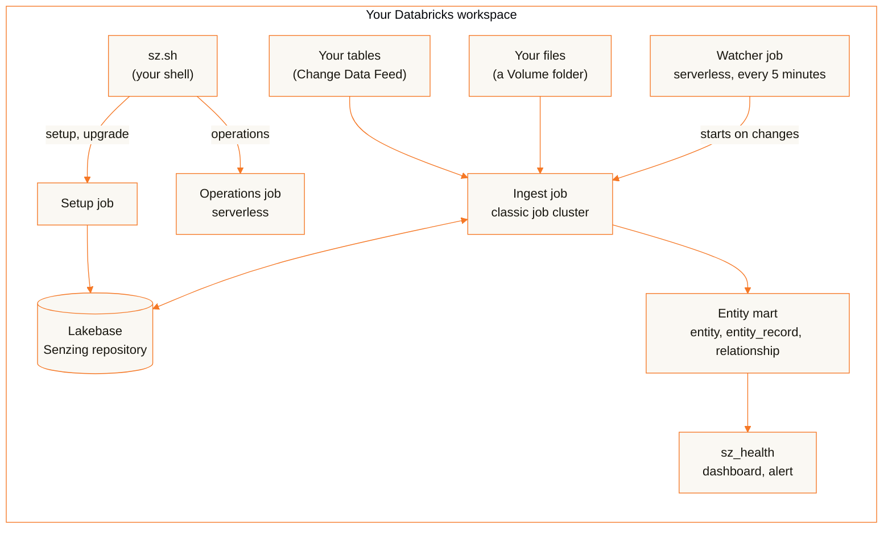

<p align="center">
  <picture>
    <source media="(prefers-color-scheme: dark)" srcset="assets/senzing-logo-dark-theme.png">
    
  </picture>
</p>

<h1 align="center">sz-databricks</h1>

<p align="center"><b>SENZING® entity resolution inside your own Databricks workspace. Senzing, Inc. hosts nothing and receives nothing.</b></p>

<p align="center">
  <a href="https://github.com/Senzing/sz-databricks/releases"></a>
  
  <a href="https://senzing.com/end-user-license-agreement/"></a>
</p>


> [!TIP]
> **Let your AI assistant do the install.** Claude Code or any assistant with a shell and a
> Databricks CLI profile can run the whole path for you from the command line: verify the
> release, install, load your tables (or the CORD sample data), watch them resolve and build a
> report on your own data joined with the results. You paste two prompts and answer its
> questions; it never accepts the Senzing End User License Agreement (EULA) for you. Connect the
> [Senzing Model Context Protocol (MCP) server](https://mcp.senzing.com/mcp) so its Senzing
> answers come from the Senzing documentation.
>
> **Start here: [install and report with an AI assistant](docs/ai-assisted.md)**

> [!IMPORTANT]
> **Public preview.** sz-databricks is provided as-is, without warranty of any kind and without a
> support commitment. Its interfaces, settings and release files can change between releases.
> Use is governed by the
> [Senzing End User License Agreement](https://senzing.com/end-user-license-agreement/).

Entity resolution works out which of your records describe the same person or organization,
across and within your sources, and how those entities relate. sz-databricks runs Senzing entity
resolution in your Databricks workspace, installed by you from one signed release with one script
and operated from the command line. Your sources are Unity Catalog tables (read incrementally
through Delta Change Data Feed) or folders of JSON lines files in a Unity Catalog Volume. The
results land in an entity mart: tables in your catalog that say which entity each record resolves
to and why. No source code is published, and nothing runs outside your workspace.

One person usually does it all: a workspace admin installs, registers the sources and queries the
results. When the work is shared, the install grants an operator group (runs `sz.sh`) and a
consumer group (reads the results) exactly what each needs.

This page is the overview and the guide for doing it by hand. The steps are in
[docs/install.md](docs/install.md), day-to-day use in [docs/use.md](docs/use.md) and what to do
when something fails in [docs/troubleshooting.md](docs/troubleshooting.md).

## How it works

You register a mapping view over your tables, or a Volume folder. A watcher job notices their
changes and starts the ingest job, which loads each change into the Senzing engine (its repository
is a Lakebase PostgreSQL database), processes the follow-up work the engine queues and writes the
entities that changed to the `entity`, `entity_record` and `relationship` tables you query. You
operate it with one script, `sz.sh`; one view, `sz_health`, says whether everything is well.



| Part | Runs as | Does |
|---|---|---|
| `sz-databricks-setup` | job, single-node classic cluster | stages the engine payload into your Volume, creates the Senzing database and role in Lakebase and the install's tables, records the EULA acceptance and checks the license |
| `sz-databricks-ingest` | job, autoscaling classic cluster | reads each source's new changes, resolves them, processes redo (follow-up work the engine queues when a change to one entity means related entities must be evaluated again) and keeps the entity mart current; stops after 10 idle minutes |
| `sz-databricks-watch` | job, serverless, every 5 minutes | starts the ingest job when a source changed, finishes a pause and reports a release that still needs `sz.sh upgrade` |
| `sz-databricks-ops` | job, serverless | one operation per run, started by `sz.sh`: register a source, pause, resume, purge and the rest |
| Lakebase project `sz-databricks` | Lakebase Autoscaling, PostgreSQL 17 | the Senzing repository; scales to zero when idle |
| `sz_health` | a view in the mart schema | one row: `overall` (`OK`, `WARN` or `FAIL`), each failing check's code and `resolve_state` |
| `sz-databricks status` and `sz-databricks health` | AI/BI dashboard, SQL alert | the dashboard shows runs, engine health, quarantined records, each source's position and the mart's counts; the alert mails you when `sz_health` is not `OK` |
| Two schemas and a Volume | Unity Catalog | `senzing` holds the entity mart and `sz_health`; `senzing_internal` holds the registry, status and bookkeeping and the Volume `files` |

The bundle creates all of it, plus a SQL warehouse (`sz-databricks-warehouse`), a secret scope, a
cluster policy for the jobs and a demo notebook. Between ingest runs only the watcher's short
scheduled runs bill.

## What a release contains

| File | Content |
|---|---|
| `sz-databricks-install-<release>.sh` | the install script: verifies the release, unpacks the bundle and installs or upgrades it ([install](docs/install.md)) |
| `sz-databricks-bundle-<release>.tar.gz` | the Databricks Asset Bundle: `databricks.yml`, `resources/`, the engine and watcher JARs in `lib/`, the demo notebook, the dashboard and the scripts `scripts/sz.sh`, `scripts/admin.sh`, `scripts/preflight.sh`, `scripts/node-sizing.sh`, `scripts/verify-release.sh` and `scripts/lakebase-setup.sql` |
| `sz-databricks-engine-shared-<release>.tar.gz` | the engine payload's shared part: the Senzing runtime the setup job stages into your Volume |
| `sz-databricks-engine-native-<release>-linux-arm64.tar.gz`, `sz-databricks-engine-native-<release>-linux-amd64.tar.gz` | the engine payload's native libraries, one archive per architecture; together with the shared archive about 600 MB |
| `sz-databricks-cord-data.tar.gz` | optional: the official Senzing [Collections Of Relatable Data (CORD)](https://senzing.com/senzing-ready-data-collections-cord/), Las Vegas collection, reshaped into normalized source tables ([below](#no-data-of-your-own-use-the-cord-data)) |
| `SHA256SUMS` | the SHA-256 checksum of every file above |
| `SHA256SUMS.sigstore.json` | the keyless cosign signature of `SHA256SUMS`: one signature covers the release |

A release is named `<senzing_version>-<build>`, for example `4.4.3-1`: the Senzing SDK version it
carries and a build counter that restarts at 1 for each Senzing SDK version, so `4.4.3-10` is a
later build than `4.4.3-7`. The tag is the release.

## Trust model

| Rule | |
|---|---|
| Everything runs in your workspace | the jobs, Lakebase, your data, logs and status |
| Senzing, Inc. hosts nothing and receives nothing | it publishes software only: the release files. Two optional steps that you start send something to Senzing, Inc.: the Senzing MCP server receives what you or your assistant send it (column names and the mapping when mapping: the mapper runs on your machine, over a sample you export there, and never sends your records), and Ask Senzing receives the details you give it when you request an evaluation license |
| One download | the setup job fetches its release's payload from this repository's GitHub release; with a Volume as the payload source it needs no egress at all |
| The payload is pinned | setup refuses any payload archive whose SHA-256 differs from the digests compiled into the release's engine JAR, so verifying the bundle verifies the payload |
| Your secrets stay in your secret scope | the license and the engine's database password live in the bundle's secret scope (`sz_databricks`): the jobs' principal reads it, the installer writes it, and no script prints either |
| Least privilege | the jobs run as a dedicated service principal (`sz-databricks-jobs`), never as you. The install grants only what [install](docs/install.md#what-the-install-grants) lists, and prints every grant in a dry run first |
| Your results stay yours | nobody but the installer and the jobs' principal can read the entity mart until you name a consumer group |

## Prerequisites

| Need | Note |
|---|---|
| An AWS Databricks workspace | with Unity Catalog, classic compute for jobs (Graviton by default; a serverless-only workspace has none, and the install script stops on one), serverless jobs, Lakebase Autoscaling (AWS only today) and serverless SQL warehouses |
| A workspace admin with MANAGE on the catalog | runs the install; the install creates a service principal for the jobs (`sz-databricks-jobs`) |
| Databricks CLI **1.23.0** or later, `jq`, `cosign`, `openssl`, `tar` | on the machine you install from (bash), with a CLI profile for the workspace; `sha256sum` or `shasum`. The bundle is validated with CLI 1.23.0; check yours with `databricks -v` |
| Outbound access from the job clusters | to `github.com`, `release-assets.githubusercontent.com` and `objects.githubusercontent.com`, for the payload download only; or stage the payload in a Volume ([install](docs/install.md#restricted-network-stage-the-payload)) |
| A Senzing license (optional) | without one the engine runs in evaluation mode and takes few records; [getting one](docs/install.md#the-license) |
| Data to resolve | your tables, a folder of Senzing JSON lines files or the [CORD data](#no-data-of-your-own-use-the-cord-data) |
| One release's files | from this repository's [releases](https://github.com/Senzing/sz-databricks/releases), in one directory |

## Sizing

By default the ingest job runs on one or two `r6g.xlarge` workers (Graviton, 4 cores, 32 GB) with
18 engine threads each, and the setup job on a single node of the same type. Each engine thread
gets 1 GB of the node's memory; the install checks that the threads you set fit the node type you
choose. Job clusters exist only while a run lasts: a run ends after 10 minutes with nothing new to
do, and the cluster stops with it. The Lakebase endpoint runs at 4 compute units (about 8 GB;
Databricks documents about 2 GB per compute unit), sized as 2 vCPU, and scales to zero after 30
idle minutes. The engine's concurrency is bounded by that Lakebase size (2 vCPU gives 24 engine
threads) and by the cluster size. Every size is a bundle variable you set at install with
`--set <name>=<value>`: see [Sizing](docs/use.md#sizing).

## What it costs to run

Everything bills to your Databricks account at your rates; this page gives no prices. The billable
parts:

| Resource | When it bills |
|---|---|
| The watcher job (serverless) | each scheduled run, every 5 minutes by default (`--set watch_cron=…`) |
| The operations job (serverless) | each `sz.sh` operation, about a minute |
| The job clusters (setup and ingest) | only during a run: an ingest run ends after 10 idle minutes and its cluster stops |
| The SQL warehouse (2X-Small, serverless) | while it answers `sz.sh status`, the dashboard, the hourly alert or your queries; it stops after 5 idle minutes |
| Lakebase | compute while awake (4 compute units by default; it scales to zero after 30 idle minutes) and the storage of the Senzing repository |
| The Volume | the staged engine payload, about 1.3 GB per release; earlier releases' payloads stay until you delete them ([upgrade](docs/use.md#upgrade)) |

Set budget alerts before you load data: a
[Databricks budget](https://docs.databricks.com/aws/en/admin/account-settings/budgets) (an account
admin sets it; it emails when the DBU spend reaches its limit) and an
[AWS budget](https://docs.aws.amazon.com/cost-management/latest/userguide/budgets-managing-costs.html)
for the job clusters' EC2 instances and EBS volumes, which AWS bills. A budget alerts and never
stops anything.

Remove everything with [Uninstall](docs/use.md#uninstall).

## The path

| # | Step | Where |
|---|---|---|
| 1 | Download the release and verify it | [below](#verify) |
| 2 | Prepare a source: Change Data Feed and a mapping view | [use](docs/use.md#prepare-a-source) |
| 3 | Install with `sz-databricks-install-<release>.sh`: accept the EULA, store the license, register the sources | [install](docs/install.md) |
| 4 | Watch it resolve: `sz.sh wait`, `sz_health` | [use](docs/use.md#watch-it-resolve) |
| 5 | Query the entity mart, the notebook and the dashboard | [use](docs/use.md#use-the-results) |
| 6 | Health, alerts, sizing, upgrade and uninstall | [use](docs/use.md) |

Prefer to have an AI assistant (Claude Code) run these steps and build a report on your results?
See [install and report with an AI assistant](docs/ai-assisted.md).

### No data of your own? Use the CORD data

`sz-databricks-cord-data.tar.gz`, a file of every release, is the CORD data for Senzing on
Databricks: the official Senzing [CORD](https://senzing.com/senzing-ready-data-collections-cord/)
data (real historical records published for evaluating entity resolution), from its Las Vegas
collection, reshaped into the normalized tables a data warehouse holds. Six source systems (a CRM,
a provider registry, a vendor master, a risk watchlist, a loan portfolio and a legal-entity
reference set) hold about 200,000 people and organizations. The original JSON Lines data is on the
[CORD page](https://senzing.com/senzing-ready-data-collections-cord/). CORD is for evaluation only,
not for operational use.

Verify it like the other files, load it with its `load.sql`
([install](docs/install.md#no-data-of-your-own-load-the-cord-data)), then map each source system to
the Senzing entity specification and register it as a source
([use](docs/use.md#register-a-source)). The tables are not yet in the Senzing entity
specification: mapping them is part of the exercise, and an AI assistant with the Senzing MCP tools
can do it ([AI-assisted](docs/ai-assisted.md#no-data-of-your-own)).

## Verify

A release carries one signature: `SHA256SUMS` is signed keyless as this repository's
`sign-release` workflow at that release's tag, and it holds the SHA-256 of every other file. Check
the signature first, then the files. The identity is exact, so an older release's signature does
not pass under a newer name. In the directory that holds the release files:

```sh
release=<release>   # the release tag, for example 4.4.3-1
cosign verify-blob --bundle SHA256SUMS.sigstore.json \
  --certificate-identity "https://github.com/Senzing/sz-databricks/.github/workflows/sign-release.yaml@refs/tags/$release" \
  --certificate-oidc-issuer https://token.actions.githubusercontent.com SHA256SUMS
sha256sum --ignore-missing -c SHA256SUMS   # macOS: shasum -a 256 --ignore-missing -c SHA256SUMS
```

`cosign` must print `Verified OK`, then every file you downloaded must print `OK`. The signature is
attached a few minutes after a release is published: the release is complete once
`SHA256SUMS.sigstore.json` is there. The bundle's engine JAR carries the payload's digests, so
verifying the bundle verifies the payload. The install script repeats these checks (the signature
against the exact identity, then the SHA-256 of each file it uses, which must be listed) before it
unpacks the bundle, and stops when one fails.
`./sz-databricks-install-<release>.sh <release> --catalog <catalog> --check-only` runs those checks
and unpacks the bundle for real, then stops: nothing in the workspace is read or changed.

## Versions

Each release is one version of everything: the bundle, the engine and watcher JARs, the scripts and
the payload. Upgrading is running the new release's install script with `--upgrade`
([upgrade](docs/use.md#upgrade)); until then `sz_health` reports `UPGRADE_PENDING` and no run
starts. An install never downgrades.

**During the public preview, any release can make breaking changes**, a build within the same
Senzing SDK version included: the scripts' options and output, the operations, the `sz_health`
columns and codes, the mart's tables, the bundle variables and the release files. Read the
[CHANGELOG](CHANGELOG.md) before you upgrade. Once out of preview, changes within a Senzing SDK
version will be additive only, and breaking changes will come with the next Senzing SDK version.

## Reference

### Lakebase connection

| Control | |
|---|---|
| TLS | `verify-full`: the engine checks the Lakebase certificate (a public Let's Encrypt certificate) against the cluster node's CA bundle |
| Setup login | the jobs' service principal, through a Lakebase OAuth role with CREATEDB and CREATEROLE and no superuser |
| Engine login | its own password role, `sz_engine`, with a password the install generates and keeps in the secret scope (`sz.sh rotate-password` replaces it); the bundle turns on native Postgres login for the project (`enable_pg_native_login`, Beta) for it |
| Idle | the endpoint scales to zero after 30 idle minutes (`lakebase_suspend`); the first connection after that waits while it wakes |

## License

sz-databricks is a public preview, provided as-is. The software is licensed under the
[Senzing End User License Agreement](https://senzing.com/end-user-license-agreement/)
([LICENSE](LICENSE)). The install asks you to accept it before it runs anything: no setup or ingest
run starts until you pass `--accept-eula` to the install script or run `sz.sh accept-eula --yes`
([install](docs/install.md#the-senzing-eula)). More about Senzing software:
[senzing.com](https://senzing.com).
